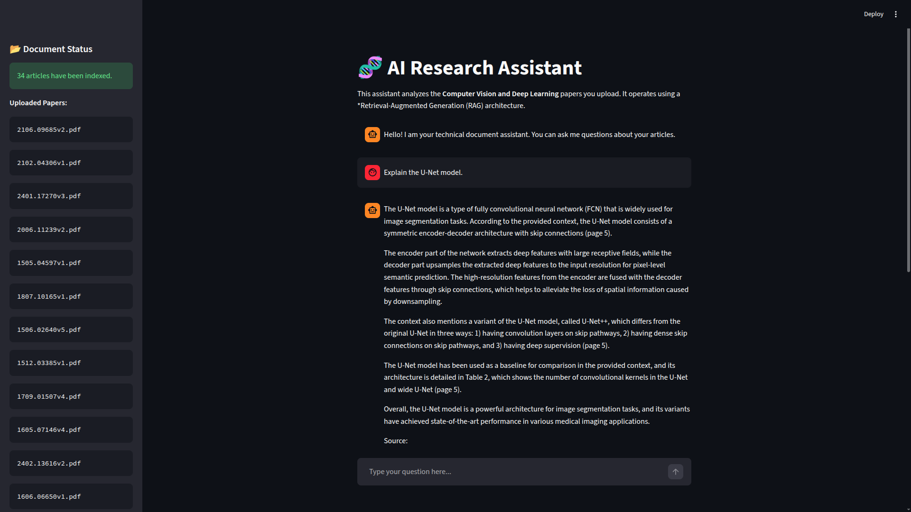
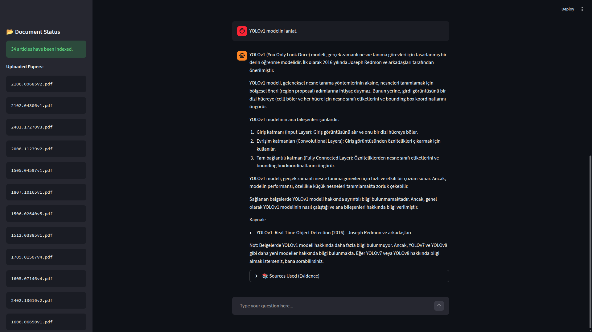
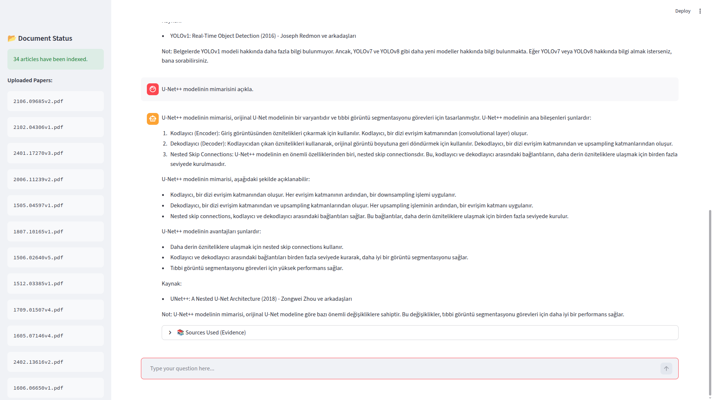

# 🧬 GenAI Research Assistant: RAG & API Integration

This project is a high-performance, **Production-Grade RAG (Retrieval-Augmented Generation)** assistant designed to analyze complex technical documents and academic papers.

It utilizes a **hybrid architecture** that combines the speed of local vectorization with the cognitive power of Cloud APIs. By leveraging the **Groq API** for inference and **optimized local embeddings**, it allows users to "chat" with their PDF documents with extremely low latency.

---

## 🚀 Architecture & Workflow

The system follows a strict technical pipeline designed for efficiency and accuracy:

1. **Data Ingestion:** PDF documents are loaded from the `data/raw` directory and split into semantic chunks.
2. **Efficient Vectorization:** Text chunks are converted into vector embeddings using the lightweight and fast **`sentence-transformers/all-MiniLM-L6-v2`** model. This runs locally on the CPU with minimal resource usage.
3. **Vector Store (ChromaDB):** Embeddings are persisted locally in a vector database for retrieval.
4. **Retrieval & Context Injection:** Relevant context is retrieved based on user queries (Similarity Search).
5. **LLM Generation:** The retrieved context and the user prompt are sent to the **Llama-3.3-70b** model (via Groq API) to generate an evidence-based answer.

### 🌟 Key Features

- **API & RAG Fusion:** Combines the general knowledge of Large Language Models with your private data.
- **Optimized Performance:** Uses `all-MiniLM-L6-v2` for fast CPU-based embedding generation, making the Docker image lightweight.
- **One-Click Setup:** Includes automated scripts (`.sh` and `.bat`) for instant local environment setup.
- **Evidence-Based Answers:** The assistant cites the specific source files used to generate the response.
- **Context-Aware Memory:** Maintains chat history to support follow-up questions and conversational flow.

---

## 📸 Screenshots & Demo

Here the system is demonstrated handling queries in multiple languages across different technical domains.

### 1. Foundational Biomedical Knowledge (English)

The model accurately retrieves information to explain core biomedical segmentation architectures like U-Net.


### 2. Multilingual Support (Turkish)

The system is capable of understanding and responding to technical queries in different languages, such as explaining YOLOv1 in Turkish.


### 3. Advanced Concepts & Light Mode UI

Handling specialized queries about evolving architectures like U-Net++, shown in the system's light theme interface.


---

## 📚 Dataset & References

This project utilizes a comprehensive collection of academic papers, ranging from foundational Deep Learning architectures to state-of-the-art Object Detection (YOLO series) and Segmentation models.

| Paper Title                                                                         | Topic              | Year   | Link                                           |
| :---------------------------------------------------------------------------------- | :----------------- | :----- | :--------------------------------------------- |
| **Adam: A Method for Stochastic Optimization**                                      | Optimization       | 2014   | [1412.6980](https://arxiv.org/abs/1412.6980)   |
| **U-Net: Convolutional Networks for Biomedical Image Segmentation**                 | Biomedical / Seg.  | 2015   | [1505.04597](https://arxiv.org/abs/1505.04597) |
| **Deep Residual Learning for Image Recognition (ResNet)**                           | Backbone / CV      | 2015   | [1512.03385](https://arxiv.org/abs/1512.03385) |
| **You Only Look Once: Unified, Real-Time Object Detection (YOLOv1)**                | Object Detection   | 2015   | [1506.02640](https://arxiv.org/abs/1506.02640) |
| **Identity Mappings in Deep Residual Networks**                                     | Backbone / CV      | 2016   | [1603.05027](https://arxiv.org/abs/1603.05027) |
| **Wide Residual Networks**                                                          | Backbone / CV      | 2016   | [1605.07146](https://arxiv.org/abs/1605.07146) |
| **Aggregated Residual Transformations (ResNeXt)**                                   | Backbone / CV      | 2016   | [1611.05431](https://arxiv.org/abs/1611.05431) |
| **YOLO9000: Better, Faster, Stronger (YOLOv2)**                                     | Object Detection   | 2016   | [1612.08242](https://arxiv.org/abs/1612.08242) |
| **Attention Is All You Need (Transformer)**                                         | NLP / Foundation   | 2017   | [1706.03762](https://arxiv.org/abs/1706.03762) |
| **Squeeze-and-Excitation Networks (SENet)**                                         | Backbone / CV      | 2017   | [1709.01507](https://arxiv.org/abs/1709.01507) |
| **MobileNetV2: Inverted Residuals and Linear Bottlenecks**                          | Mobile / CV        | 2018   | [1801.04381](https://arxiv.org/abs/1801.04381) |
| **YOLOv3: An Incremental Improvement**                                              | Object Detection   | 2018   | [1804.02767](https://arxiv.org/abs/1804.02767) |
| **EfficientNet: Rethinking Model Scaling for CNNs**                                 | Backbone / CV      | 2019   | [1905.11946](https://arxiv.org/abs/1905.11946) |
| **EfficientDet: Scalable and Efficient Object Detection**                           | Object Detection   | 2019   | [1911.09070](https://arxiv.org/abs/1911.09070) |
| **YOLOv4: Optimal Speed and Accuracy of Object Detection**                          | Object Detection   | 2020   | [2004.10934](https://arxiv.org/abs/2004.10934) |
| **Retrieval-Augmented Generation for Knowledge-Intensive NLP Tasks (RAG)**          | GenAI / RAG        | 2020   | [2005.11401](https://arxiv.org/abs/2005.11401) |
| **An Image is Worth 16x16 Words: Transformers for Image Recognition (ViT)**         | Vision Transformer | 2020   | [2010.11929](https://arxiv.org/abs/2010.11929) |
| **EfficientNetV2: Smaller Models and Faster Training**                              | Backbone / CV      | 2021   | [2104.00298](https://arxiv.org/abs/2104.00298) |
| **LoRA: Low-Rank Adaptation of Large Language Models**                              | LLM / Fine-tuning  | 2021   | [2106.09685](https://arxiv.org/abs/2106.09685) |
| **YOLOv7: Trainable Bag-of-Freebies**                                               | Object Detection   | 2022   | [2207.02696](https://arxiv.org/abs/2207.02696) |
| **Segment Anything (SAM)**                                                          | Segmentation       | 2023   | [2304.02643](https://arxiv.org/abs/2304.02643) |
| **YOLOv9: Learning What You Want to Learn Using Programmable Gradient Information** | Object Detection   | 2024   | [2402.13616](https://arxiv.org/abs/2402.13616) |
| **YOLOv10: Real-Time End-to-End Object Detection**                                  | Object Detection   | 2024   | [2405.14458](https://arxiv.org/abs/2405.14458) |
| _Other Technical Reports_                                                           | _Deep Learning_    | _Misc_ | [arXiv Index](https://arxiv.org/)              |

## 🛠️ Installation & Setup

### 0. Prerequisites (API Key)

You need a Groq API Key to run the inference engine.

1. Rename `config/config_example.py` to `config.py`.
2. Paste your API key inside the file:

```python
# config/config.py
GROQ_API_KEY = "gsk_..."

```

### Method 1: Running with Docker (Recommended) 🐳

This is the cleanest method. You do not need Python installed, only Docker Desktop.

```bash
# 1. Build and Start the Container
docker compose up --build

# 2. Access the Application
# Open your browser and go to: http://localhost:8501

```

### Method 2: Automated Local Setup (Quick Start) ⚡

If you prefer running locally without Docker, use the provided automation scripts. These scripts automatically handle virtual environment creation, dependency installation, data ingestion, and app launch.

**For Linux / macOS Users:**

```bash
# Give execution permission (only once)
chmod +x run_linux.sh

# Run the script
./run_linux.sh

```

**For Windows Users:**
Simply double-click the **`run_windows.bat`** file.

_Note: Ensure you have placed your PDF files in the `data/raw/` directory before running the scripts._

---

## 📂 Project Structure

```text
rag-genai-assistant/
├── config/             # Configuration files and API Keys
├── data/
│   └── raw/            # Upload your PDF documents here
├── logs/               # System logs (Ingestion and Chat history)
├── src/
│   ├── data_ingestion.py  # Handles document loading and embedding generation
│   ├── engine.py          # Core logic for the Chat Engine
│   ├── llm_setup.py       # Initialization of Groq API and Embedding models
│   ├── retriever.py       # Custom retrieval logic
│   └── utils/
│       └── logger.py      # Centralized logging configuration
├── vector_db/          # Persistent storage for ChromaDB
├── app.py              # Streamlit Frontend Application
├── docker-compose.yml  # Docker orchestration file
├── Dockerfile          # Optimized Docker image definition
├── run_linux.sh        # Automated setup script for Linux/Mac
└── run_windows.bat     # Automated setup script for Windows

```

---

## 🧪 Tech Stack

| Component           | Technology           | Description                                       |
| ------------------- | -------------------- | ------------------------------------------------- |
| **LLM Inference**   | Meta Llama 3.3 (70B) | Powered by Groq API for ultra-fast generation.    |
| **Orchestration**   | LlamaIndex           | Framework for connecting LLMs with external data. |
| **Vector DB**       | ChromaDB             | Open-source embedding database.                   |
| **Embedding Model** | **all-MiniLM-L6-v2** | High-speed, CPU-friendly sentence transformer.    |
| **Frontend**        | Streamlit            | Interactive web interface.                        |
| **Deployment**      | Docker               | Containerization and environment isolation.       |

---

## 📧 Contact

**Developer:** Ozan Bozyel

**Role:** Biomedical & Deep Learning Engineer

**LinkedIn:** [Ozan Bozyel](https://www.linkedin.com/in/ozan-bozyel)

**GitHub:** [BozyelOzan](https://github.com/BozyelOzan)

---

_This project is open-source and intended for educational and research purposes._
