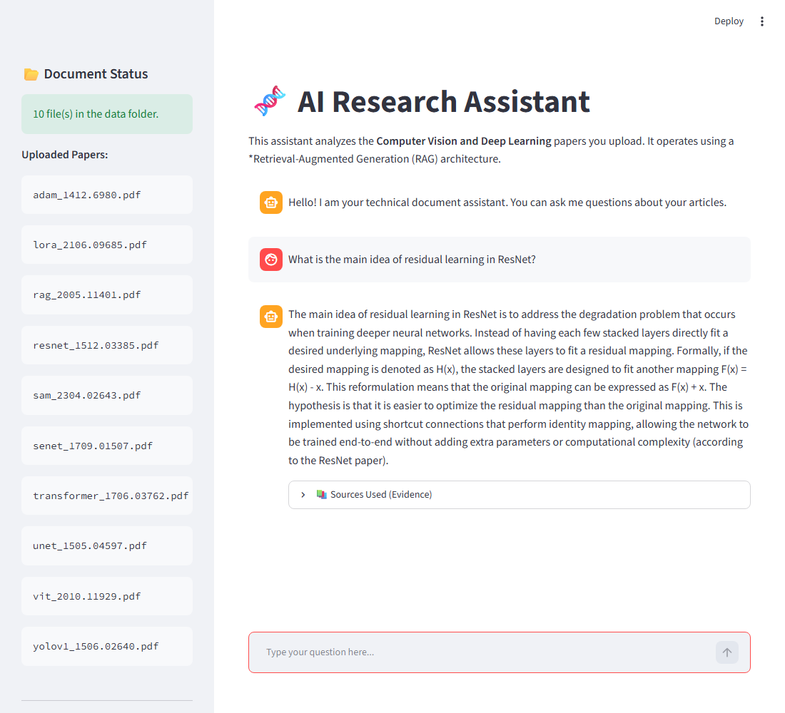
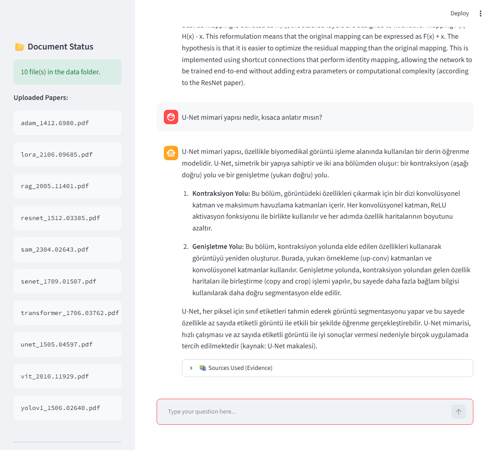

# 🧬 AI Research Assistant: RAG over Academic Papers

A Retrieval-Augmented Generation (RAG) chatbot that answers questions about your own PDF papers. Answers are grounded in the uploaded documents, cite their source file and page, and can be given in English or Turkish.

The pipeline combines **local embeddings and reranking** (no API cost) with a **hosted LLM** (Groq or OpenAI, selectable via configuration).

---

## Key Features

- **Grounded answers with citations:** every answer lists the source file, page number and retrieval score.
- **Two-stage retrieval:** a wide vector search (top-60) followed by a cross-encoder reranker (`BAAI/bge-reranker-base`) that keeps the best 5 chunks.
- **Conversational memory:** follow-up questions are rewritten into standalone queries before retrieval.
- **Provider choice:** run with the Groq free tier or with an OpenAI API key, changed with a single environment variable.
- **Incremental indexing:** PDFs added to the data folder are indexed on the next start; existing chunks are not re-processed.
- **Bilingual:** questions in Turkish get Turkish answers, English questions get English answers.
- **Reproducible setup:** Docker Compose, or one-click scripts for Windows and Linux/macOS.
- **Measured quality:** an automated evaluation covering retrieval (Hit@5, MRR), answer faithfulness, relevance and refusal behaviour, plus unit tests (see [Evaluation](#evaluation)).

---

## Architecture

```
PDFs (data/raw)
   │
   ▼
Parsing (LlamaIndex SimpleDirectoryReader + pypdf)
   │
   ▼
Chunking (512 tokens) → Embeddings (all-MiniLM-L6-v2, local CPU)
   │
   ▼
ChromaDB (persistent vector store)
   │
   ▼  question
Condense question (follow-ups) → Vector search (top-60)
   │
   ▼
Reranker (bge-reranker-base, local) → top-5 chunks
   │
   ▼
LLM (Groq or OpenAI) → answer with sources
```

---

## Tech Stack

| Component       | Technology                                   |
| --------------- | -------------------------------------------- |
| Orchestration   | LlamaIndex (`condense_plus_context` engine)  |
| LLM             | Groq (`openai/gpt-oss-120b`) or OpenAI (`gpt-4o-mini`) |
| Embeddings      | `sentence-transformers/all-MiniLM-L6-v2` (local) |
| Reranker        | `BAAI/bge-reranker-base` (local)             |
| Vector database | ChromaDB (persistent, local)                 |
| PDF parsing     | pypdf via LlamaIndex PDF reader              |
| Frontend        | Streamlit                                    |
| Deployment      | Docker / Docker Compose                      |

---

## Getting Started

### 1. Prerequisites

- An API key from **one** of the following providers:
  - **Groq** (free tier available): <https://console.groq.com>
  - **OpenAI** (pay-as-you-go): <https://platform.openai.com>
- Either Docker Desktop, or Python 3.11+ for the local setup.

### 2. Configure

Copy the example environment file and fill in your key:

```bash
cp .env.example .env        # Windows: copy .env.example .env
```

Then edit `.env`:

```env
LLM_PROVIDER=groq            # or: openai
GROQ_API_KEY=gsk_...         # required when LLM_PROVIDER=groq
OPENAI_API_KEY=sk-...        # required when LLM_PROVIDER=openai
LLM_MODEL_NAME=              # optional; defaults to the provider's model (see below)
```

The `.env` file is ignored by git and excluded from the Docker image, so your keys stay local.

### 3. Add your papers

Place PDF files in `data/raw/`. The folder is created automatically on first run.

### 4. Run

**Option A: Docker (recommended)**

```bash
docker compose up --build
```

Open <http://localhost:8501>.

**Option B: One-click scripts**

- Windows: double-click `run_windows.bat`
- Linux / macOS: `chmod +x run_linux.sh && ./run_linux.sh`

The scripts create a virtual environment, install dependencies, build the vector index and start the Streamlit app.

**Option C: Manual**

```bash
python -m venv .venv
source .venv/bin/activate          # Windows: .venv\Scripts\activate
pip install -r requirements.txt
python src/data_ingestion.py       # builds or updates the index
streamlit run app.py
```

> The first run downloads the local embedding model (~90 MB) and the reranker (~1 GB). Later runs use the cached copies.

---

## Configuration

| Variable               | Default                                | Description                                   |
| ---------------------- | -------------------------------------- | --------------------------------------------- |
| `LLM_PROVIDER`         | `groq`                                 | `groq` or `openai`                            |
| `GROQ_API_KEY`         | —                                      | Required when `LLM_PROVIDER=groq`             |
| `OPENAI_API_KEY`       | —                                      | Required when `LLM_PROVIDER=openai`           |
| `LLM_MODEL_NAME`       | `openai/gpt-oss-120b` (groq) / `gpt-4o-mini` (openai) | Chat model                    |
| `EMBEDDING_MODEL_NAME` | `sentence-transformers/all-MiniLM-L6-v2` | Local embedding model                       |
| `RERANKER_MODEL_NAME`  | `BAAI/bge-reranker-base`               | Local reranker model                          |
| `CHUNK_SIZE`           | `512`                                  | Chunk size in tokens                          |
| `SIMILARITY_TOP_K`     | `60`                                   | Candidates retrieved before reranking         |
| `RERANK_TOP_N`         | `5`                                    | Chunks passed to the LLM                      |
| `DATA_FILE`            | `data/raw`                             | Folder with PDF files                         |
| `VECTOR_DB_FILE`       | `vector_db`                            | ChromaDB storage folder                       |

> **Changing the embedding model** requires deleting `vector_db/` and re-indexing, because vectors from different models are not comparable.

---

## Evaluation

The evaluation runner exercises the same pipeline as the app (index → vector search → reranker → chat engine → LLM) on a labelled test set.

**Test set** (`tests/test_questions.json`): 37 questions in English and Turkish over 10 papers.

- **33 in-scope questions** across ResNet, YOLOv1, U-Net, Adam, Transformer, SENet, RAG, LoRA, ViT and SAM. Each question records the expected paper and expected keywords.
- **4 out-of-scope questions** (a football result, the weather, a Python how-to, a cooking recipe). The correct behaviour is to refuse, because the papers do not contain these answers.

### Metrics

| Metric | What it measures | How it is computed |
| ------ | ---------------- | ------------------ |
| Hit@5 | Is a relevant chunk among the top 5? | A chunk is *relevant* if it comes from the expected paper and contains an expected keyword. Reported for raw vector search and after reranking (what the LLM sees). |
| Hit@60 | Is a relevant chunk among the 60 candidates? | Same definition, over the raw vector search results. |
| MRR | How high is the first relevant chunk? | Mean reciprocal rank, for raw and reranked lists. |
| Keyword hit | Does the answer contain an expected term? | Case-insensitive substring check (English and Turkish terms). |
| Faithfulness | Is every claim supported by the retrieved context? | LLM-as-judge (the app's own LLM), JSON output. |
| Relevance | Does the answer address the question? | LLM-as-judge. |
| Refusal | Does the system refuse out-of-scope questions? | Phrase check in English and Turkish. |
| Latency | Where does the time go? | Vector retrieval, reranking and end-to-end time per question. |

**Run it:**

```bash
python tests/run_eval.py                                          # full set
python tests/run_eval.py --only en_out_of_scope_worldcup          # subset, merged into results.json
```

Results, including every answer, its sources and per-question scores, are written to `tests/results.json`.

**Unit tests** (no API calls, 14 tests covering error messages, configuration validation, PDF discovery and evaluation helpers):

```bash
pip install -r requirements-dev.txt
python -m pytest tests -q
```

### Results

Run on **2026-10-30** with `LLM_PROVIDER=openai`, model `gpt-4o-mini`, reranker `BAAI/bge-reranker-base`, embeddings `all-MiniLM-L6-v2`. The index contains the 10 papers listed in the [Dataset](#dataset) section, indexed incrementally.

| Metric | Result |
| ------ | ------ |
| Questions passed | **35 / 37** |
| Hit@5, vector search only | 84.8 % |
| Hit@5, after reranking | **93.9 %** |
| Hit@60, vector search | 100 % |
| MRR, vector search → after reranking | 0.643 → **0.789** |
| Keyword hit (in-scope) | 100 % (33 / 33) |
| Faithfulness (LLM-as-judge) | 97 % (32 / 33) |
| Relevance (LLM-as-judge) | 100 % (33 / 33) |
| Refusal (out-of-scope) | **100 % (4 / 4)** |
| Latency per question | median 18.7 s, p90 20.9 s |
| Of which: reranking (CPU) | mean 13.6 s |
| Of which: vector retrieval | mean 0.02 s |

The reranker roughly doubles MRR and raises Hit@5 by about 9 points, while the vector search alone already finds a relevant chunk within the top 60 for every in-scope question.

### Failure analysis

- **`tr_transformer_encoder`** (Turkish, "How many identical layers does the encoder have?"): the answer is correct ("6 özdeş katman"), but the judge marked it as not fully faithful. The cause was not investigated further. The relevant chunk was also missing from the reranked top 5.
- **`en_senet_squeeze`** (English, "What does the squeeze operation compute?"): the answer is correct and matches the paper, but the expected chunk missed the reranked top 5 in this run. It was found in the previous run, so this part of retrieval is not fully deterministic.

### Changes between runs

An earlier run of the same 37 questions passed 33 / 37 (`tests/results_before_prompt_fix.json`). Two changes were made before the final run:

1. **System prompt tightened.** Two out-of-scope questions were answered from general knowledge (a Python sorting how-to and a pasta recipe). The prompt now requires answers to come only from the context. Refusal went from 2 / 4 to 4 / 4.
2. **Two keyword lists broadened after reading the answers.** The answers to "How many attention heads…" and "How many encoder layers…" were correct, but the lists only contained the written-out forms ("eight", "six"). The keywords "8" and "6" were added. This was done after seeing the results, so it reflects test tuning rather than an independent check.

### Limitations

- **Small test set.** 37 questions over 10 papers is a development-level evaluation. It shows the pipeline works on these documents; it is not a general benchmark.
- **Judge bias.** Faithfulness and relevance are judged by the same LLM family that generates the answers, so the scores can be optimistic. Keyword checks are heuristic.
- **Single run.** LLM output and retrieval ties can vary between runs; results come from one run per configuration.
- **Latency.** Reranking on CPU dominates response time. The numbers were measured on a CPU-only machine and have not been tested on a GPU.

---

## Known Limitations

- On rate-limit responses, the OpenAI-compatible SDK waits and retries before failing, so the user may wait a long time before seeing the "rate limit reached" message.
- With the Groq free tier, the default model has a daily token limit (200,000 tokens) and a per-minute limit. Heavy use or evaluation runs can exhaust it; the OpenAI provider does not have this constraint in the same way.
- Deleting a PDF from `data/raw/` does not remove its chunks from the index. Delete `vector_db/` and re-run ingestion to rebuild.
- No authentication: the app is intended for local or private use.

---

## Project Structure

```text
AI-RAG-Essay-Assistant/
├── app.py                     # Streamlit frontend
├── config/
│   ├── __init__.py
│   └── settings.py            # Reads configuration from .env
├── src/
│   ├── data_ingestion.py      # PDF parsing, chunking, indexing, incremental updates
│   ├── engine.py              # Chat engine construction and CLI mode
│   ├── llm_setup.py           # Groq / OpenAI LLM and embedding model setup
│   ├── prompts.py             # System prompt
│   ├── retriever.py           # Reranker configuration
│   └── utils/
│       ├── errors.py          # User-facing messages for provider errors
│       └── logger.py          # Logging (console and logs/app.log)
├── scripts/
│   ├── debug_retrieval.py     # Inspect vector search and reranker results
│   └── inspect_file.py        # Check which files are in the vector database
├── tests/
│   ├── test_questions.json    # Labelled evaluation set (37 questions)
│   ├── run_eval.py            # Evaluation runner (retrieval, judge, latency)
│   ├── test_units.py          # Unit tests (no API calls)
│   ├── results.json           # Latest evaluation results
│   └── results_before_prompt_fix.json  # Earlier run, kept for comparison
├── data/raw/                  # Your PDF files (not tracked by git)
├── vector_db/                 # ChromaDB storage (generated)
├── Dockerfile
├── docker-compose.yml
├── requirements.txt
├── requirements-dev.txt       # Adds pytest for running the tests
├── run_linux.sh
└── run_windows.bat
```

---

## Dataset

The evaluation index uses the 10 papers below. The others are listed as references for further experiments. The PDFs are not included in the repository; download them from arXiv and place them in `data/raw/`.

**Papers used in the evaluation:** U-Net, ResNet, YOLOv1, Adam, Transformer, SENet, RAG, LoRA, ViT, SAM.

| Paper Title                                                                         | Topic              | Year   | Link                                           |
| :---------------------------------------------------------------------------------- | :----------------- | :----- | :--------------------------------------------- |
| **Adam: A Method for Stochastic Optimization**                                      | Optimization       | 2014   | [1412.6980](https://arxiv.org/abs/1412.6980)   |
| **U-Net: Convolutional Networks for Biomedical Image Segmentation**                 | Biomedical / Seg.  | 2015   | [1505.04597](https://arxiv.org/abs/1505.04597) |
| **Deep Residual Learning for Image Recognition (ResNet)**                           | Backbone / CV      | 2015   | [1512.03385](https://arxiv.org/abs/1512.03385) |
| **You Only Look Once: Unified, Real-Time Object Detection (YOLOv1)**                | Object Detection   | 2015   | [1506.02640](https://arxiv.org/abs/1506.02640) |
| **Identity Mappings in Deep Residual Networks**                                     | Backbone / CV      | 2016   | [1603.05027](https://arxiv.org/abs/1603.05027) |
| **Wide Residual Networks**                                                          | Backbone / CV      | 2016   | [1605.07146](https://arxiv.org/abs/1605.07146) |
| **Aggregated Residual Transformations (ResNeXt)**                                   | Backbone / CV      | 2016   | [1611.05431](https://arxiv.org/abs/1611.05431) |
| **YOLO9000: Better, Faster, Stronger (YOLOv2)**                                     | Object Detection   | 2016   | [1612.08242](https://arxiv.org/abs/1612.08242) |
| **Attention Is All You Need (Transformer)**                                         | NLP / Foundation   | 2017   | [1706.03762](https://arxiv.org/abs/1706.03762) |
| **Squeeze-and-Excitation Networks (SENet)**                                         | Backbone / CV      | 2017   | [1709.01507](https://arxiv.org/abs/1709.01507) |
| **MobileNetV2: Inverted Residuals and Linear Bottlenecks**                          | Mobile / CV        | 2018   | [1801.04381](https://arxiv.org/abs/1801.04381) |
| **YOLOv3: An Incremental Improvement**                                              | Object Detection   | 2018   | [1804.02767](https://arxiv.org/abs/1804.02767) |
| **EfficientNet: Rethinking Model Scaling for CNNs**                                 | Backbone / CV      | 2019   | [1905.11946](https://arxiv.org/abs/1905.11946) |
| **EfficientDet: Scalable and Efficient Object Detection**                           | Object Detection   | 2019   | [1911.09070](https://arxiv.org/abs/1911.09070) |
| **YOLOv4: Optimal Speed and Accuracy of Object Detection**                          | Object Detection   | 2020   | [2004.10934](https://arxiv.org/abs/2004.10934) |
| **Retrieval-Augmented Generation for Knowledge-Intensive NLP Tasks (RAG)**          | GenAI / RAG        | 2020   | [2005.11401](https://arxiv.org/abs/2005.11401) |
| **An Image is Worth 16x16 Words: Transformers for Image Recognition (ViT)**         | Vision Transformer | 2020   | [2010.11929](https://arxiv.org/abs/2010.11929) |
| **EfficientNetV2: Smaller Models and Faster Training**                              | Backbone / CV      | 2021   | [2104.00298](https://arxiv.org/abs/2104.00298) |
| **LoRA: Low-Rank Adaptation of Large Language Models**                              | LLM / Fine-tuning  | 2021   | [2106.09685](https://arxiv.org/abs/2106.09685) |
| **YOLOv7: Trainable Bag-of-Freebies**                                               | Object Detection   | 2022   | [2207.02696](https://arxiv.org/abs/2207.02696) |
| **Segment Anything (SAM)**                                                          | Segmentation       | 2023   | [2304.02643](https://arxiv.org/abs/2304.02643) |
| **YOLOv9: Learning What You Want to Learn Using Programmable Gradient Information** | Object Detection   | 2024   | [2402.13616](https://arxiv.org/abs/2402.13616) |
| **YOLOv10: Real-Time End-to-End Object Detection**                                  | Object Detection   | 2024   | [2405.14458](https://arxiv.org/abs/2405.14458) |

---

## Screenshots

**English question with a cited answer (ResNet)**


**Turkish question, answered in Turkish (U-Net)**


---

## Author

**Ozan Bozyel**: Biomedical & Deep Learning Engineer

- LinkedIn: [Ozan Bozyel](https://www.linkedin.com/in/ozan-bozyel)
- GitHub: [BozyelOzan](https://github.com/BozyelOzan)

## License

Released under the [MIT License](LICENSE).
